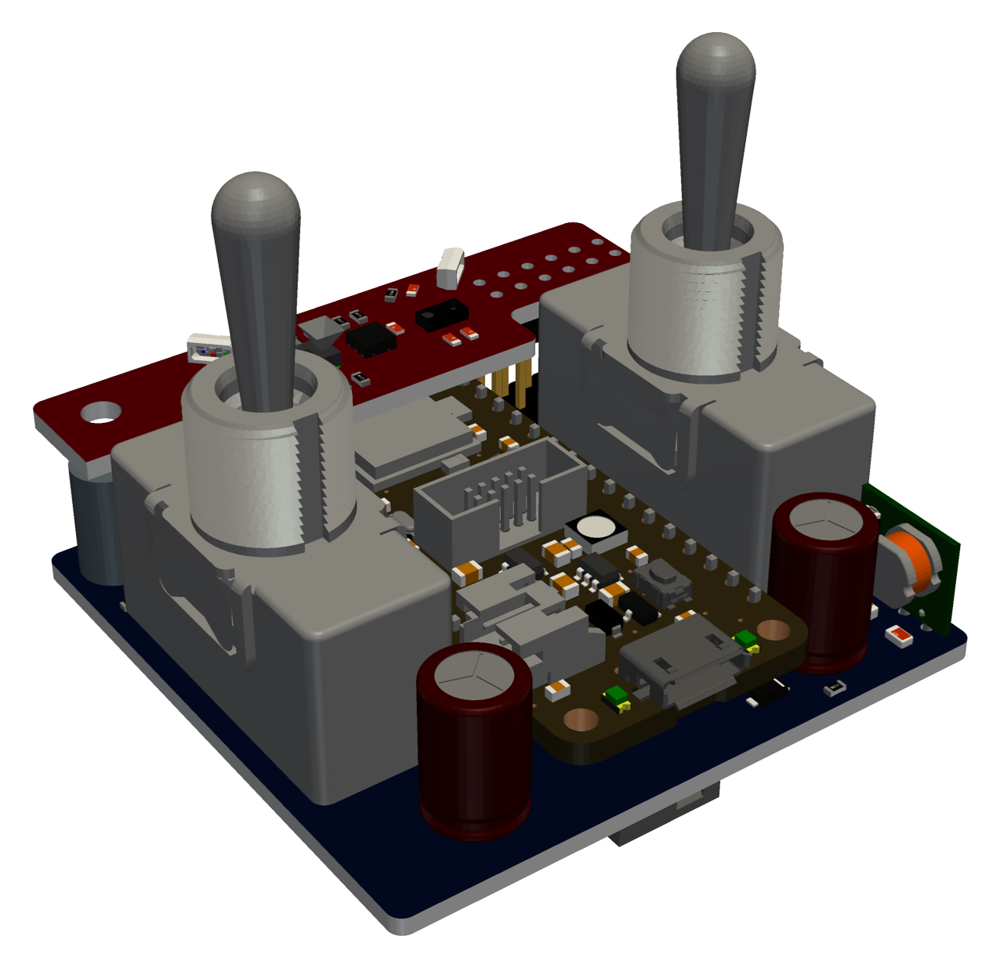
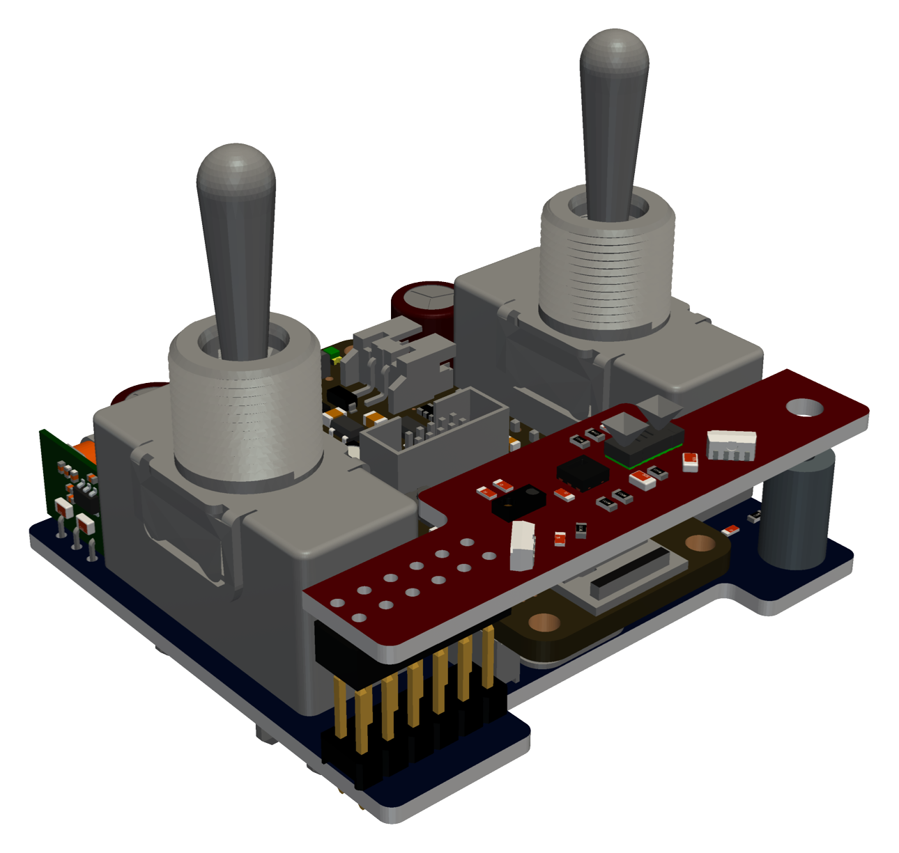
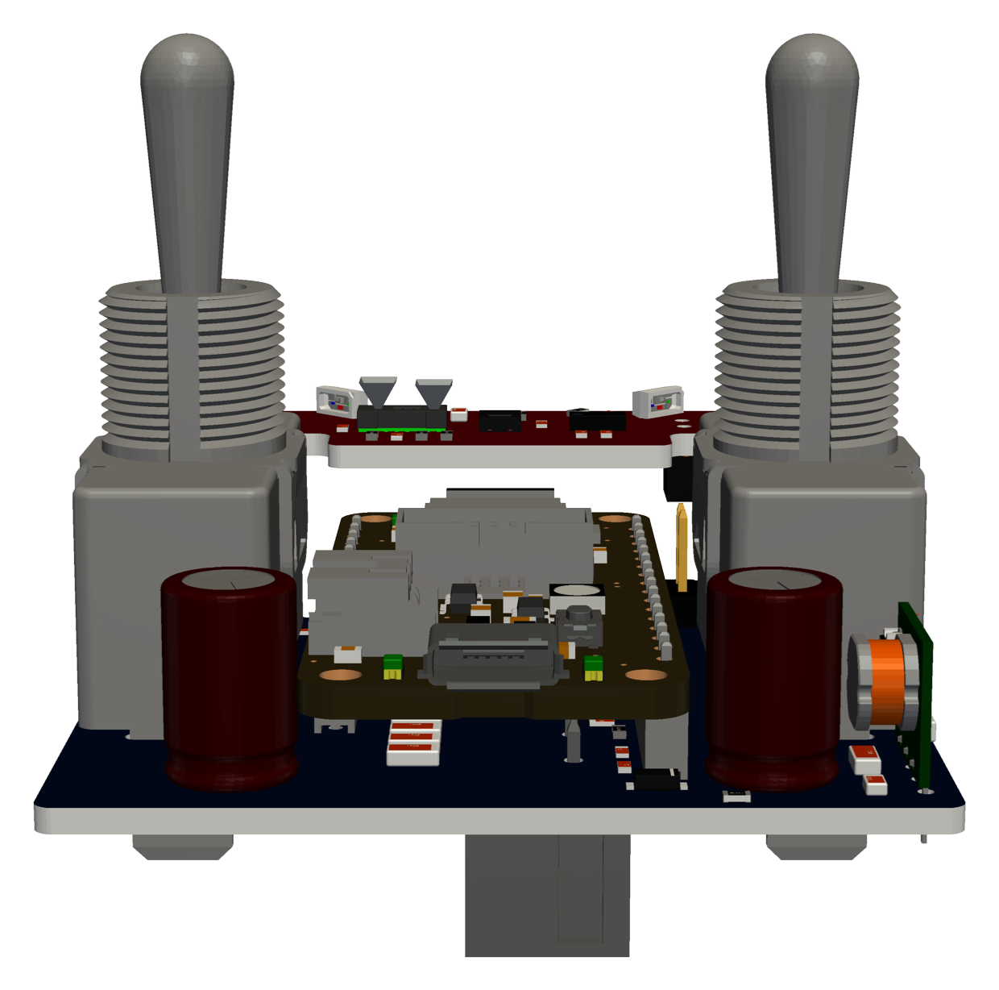

# knixx thunder

**Flip a switch, sense the room, speak KNX.**

knixx thunder is a KNX TP1 bus device built on an
[Adafruit Feather nRF52840 Express](https://www.adafruit.com/product/4062)
and the knixx Thunder and Thunder Sensor boards (schematics in `pcb/`). It is
written in Go and compiled with [TinyGo](https://tinygo.org). It talks to the
KNX bus through an onsemi NCN5121 transceiver on UART0 at 38400 baud.

<p align="center">
  
  
  
</p>

## Functionality

- **Wall switches.** Two momentary dual-throw toggles, A and B.
  - A press up or down sends a DPT 1.001 on or off group value write to each
    group address the switch is bound to, up to 8.
  - The telegrams go out one at a time. Each waits for the NCN5121's
    L_Data.con, which confirms that the bus acknowledged it, for at most
    500 ms.
  - Each throw pulls its pin low; the contacts are debounced on the board.
  - Holding A on and B off together for more than 5 s does `nus on`.
    Holding A off and B on does `nus off`. The two presses that start a
    gesture switch the lights as usual.
- **Temperature and humidity.** An SHT20 on I2C1 is read every 60 s, the
  first time 5 s after boot. The readings are published as DPT 9.001 (°C)
  and DPT 9.007 (%) to their group addresses.
- **Illuminance.** The ambient light sensor of a Vishay VCNL4040 on I2C1 is
  read on the same 60 s rhythm and published as DPT 9.004 (lux), from 0 to
  6553.5 lx in steps of 0.1 lx.
  - The ALS measures continuously while powered on, drawing about 260 µA.
    To keep it low-power, it is powered on for a single measurement of
    about 160 ms per minute and shut down again, which averages under 1 µA.
  - Its proximity sensor and interrupt are not used and stay off.
- **Occupancy.** A VL53L7CX multizone time-of-flight sensor runs its motion
  indicator in autonomous ranging mode at 4x4 zones, with a detection
  threshold on each zone.
  - The sensor pulses its INT pin for every frame in which a zone's motion
    exceeds the threshold.
  - The first motion sends DPT 1.018 *occupied*, and further motion restarts
    the timeout.
  - Once the timeout passes without motion, *not occupied* is sent.
- **Status LEDs.** Two WS2812B RGB LEDs show the device state. LED1 plays
  its modes below one after another, in the order they were triggered. LED2
  shows the BLE console, independently of LED1.

  | mode | LED1 | length | trigger |
  |---|---|---|---|
  | init | blinks yellow at 5 Hz | until the ToF's first start, at most 10 s | boot |
  | occupancy | one 50 ms green pulse, then 50 ms dark | 100 ms | each motion frame of the ToF |
  | error | 10 ms red flash every 100 ms | 0.5 s | any error the firmware reports |
  | ble | LED2: 50 ms blue pulse every 1 s | until `nus off` or the idle timeout | `nus on` |

  The errors include:
  - a sensor that fails;
  - a full tx queue;
  - a telegram without a positive L_Data.con;
  - a configuration that falls back to the built-in default.
- **Configuration.** The settings are kept in `knixx.ini` on a littlefs on
  the Feather's external QSPI flash.
  - They are edited live from the console. A change is validated, applied
    without a reboot and saved.
  - Without a usable flash or file, the firmware runs with the built-in
    default.
- **Console.** A command shell on the USB CDC port, with line editing and a
  history on the up and down keys.

  | command | function |
  |---|---|
  | `help` | list the commands |
  | `switch <A\|B> <on\|off>` | send the telegrams of a wall switch press |
  | `sniff [on\|off]` | show or toggle the trace of the NCN5121 indications and the decoded telegrams on the bus |
  | `stat` | report the transceiver state (U_State.ind) and system status (U_SystemStat.ind) |
  | `config [dump \| init \| get <key> \| set <key> <value>]` | see [Configuration](#configuration) |
  | `sensor` | the latest temperature, humidity and illuminance reading |
  | `tof` | the ToF state, settings, warnings, motion count and the per zone motion of the last motion frame |
  | `nus [on\|off]` | show the BLE console state, move the console to BLE NUS or back to USB |
  | `ota` | reboot into the bootloader for a BLE firmware update, see [Over-the-air update](#over-the-air-update) |
  | `version` | the commit and build time of the firmware, also shown in the banner |

  Use `screen /dev/ttyACM0` or a similar terminal. `tinygo monitor` garbles
  pasted input.
- **BLE console.** `nus on` moves the console from USB to the Nordic UART
  Service (NUS) on BLE. Holding A on + B off on the wall switches for more
  than 5 s does the same, and A off + B on does `nus off`.
  - The board advertises as `knixx`. Any NUS terminal can connect, such as
    nRF Connect or Serial Bluetooth Terminal, one central at a time.
  - `make nus` connects from a Linux or macOS terminal with the computer's
    own Bluetooth (`go run ./nusterm` in `src/`). Keys go to the board as
    on USB, and Ctrl-] quits. `ADDR=` selects a board.
    - **Linux:** it goes through BlueZ, so `bluetoothd` must run; no root
      is needed. `ADDR=` is the MAC address. If every piece of output shows
      twice, BlueZ is sending each notification twice from stale state it
      cached for the board; `bluetoothctl remove <address>` clears it.
    - **macOS:**
      - The first run asks to give the terminal app access to Bluetooth.
      - macOS hides MAC addresses, so `ADDR=` is the UUID that macOS gives
        the board.
      - The tool uses CoreBluetooth through cgo, so build it on the Mac
        itself.
  - LED2 pulses blue once a second while the console is on BLE.
  - The board asks the central for a 15 ms connection interval, which keeps
    typing responsive.
  - The banner shows on the first key. Output to the console, including bus
    and sensor errors, then goes to BLE.
  - `nus off`, typed over BLE, drops the connection, stops advertising and
    moves the console back to USB.
  - The console also goes back to USB after 60 s without a connected
    central, counted from `nus on` or the last disconnect, and on reset,
    since BLE is off at boot.
- **Host tool.** `src/ftdi` runs the same shell and bus logic on a PC. It
  drives the NCN5121 through an FTDI USB-serial adapter and uses the ini
  file given by `-config`, `knixx.ini` by default. The `sensor` and `tof`
  commands, the BLE console and the occupancy input exist only on the nRF.

## Building and testing

Requirements:
- TinyGo 0.43.0, installed in `/usr/local/lib/tinygo`;
- Go for the host build and tests;
- libftdi for `src/ftdi`;
- a C compiler, only to regenerate the VL53L7CX golden test log;
- `adafruit-nrfutil` (`pip install adafruit-nrfutil`) for `make dfu` and
  `make ota`, and a Bluetooth adapter with BlueZ for `make ota`.

```sh
make nrf     # build build/knixx.uf2
make flash   # build and flash the Feather
make dfu     # build the DFU package build/knixx-dfu.zip, if the sources changed
make ota     # build the DFU package if needed and flash it over BLE; ADDR=<mac> picks a board
make test    # go vet and go test ./... on the host
```

**Version.** The nrf builds embed the short commit hash, with `-dirty` when
tracked files differ from it, and the build time in UTC, through `-ldflags
-X` on `knixx/version`. A commit rebuilds the DFU package even when no
source changed.

**Patched TinyGo.** The firmware builds with the system TinyGo install.
When `patches/` holds patches for its version
(`patches/tinygo-<version>-*.patch`), the Makefile instead copies the install
to `tinygo/root-<version>` once, applies them there and exports `TINYGOROOT`;
the copy is rebuilt whenever a patch changes. TinyGo 0.43.0 needs no patches:
it includes the nRF52840 USB device driver fixes (tinygo-org/tinygo#5794)
that 0.42.0 needed patches for, which kept the console from locking up while
browsing the history or pasting text.

**Regenerated files.** `go generate ./internal/vl53l7cx`, run in `src/`,
regenerates two kinds of files:
- the sensor firmware blobs in `internal/vl53l7cx/firmware/`, extracted from
  ST's `vl53l7cx_buffers.h`;
- the golden log `internal/vl53l7cx/testdata/configure.golden` of ST's C
  driver.

### Over-the-air update

1. Run `make ota` on the host. It builds `build/knixx-dfu.zip` if needed,
   then waits up to 60 s for a bootloader in BLE DFU mode.
2. Type `ota` on the USB console or the BLE console. The firmware writes
   0xA8 to GPREGRET and resets. If the SoftDevice runs after `nus on`, the
   write goes through the SoftDevice. The Adafruit bootloader then starts its
   BLE DFU mode and advertises as `AdaDFU`.
3. `make ota` connects and sends the package with the legacy Nordic DFU
   protocol. The bootloader validates and starts the new firmware.

Phone apps that speak legacy DFU, such as nRF Connect or Bluefruit Connect,
can also send `build/knixx-dfu.zip`.

Caveats:
- `ota` resets the board: a telegram in flight is lost and the occupancy
  state is cleared.
- The bootloader stays in DFU mode until it gets an update or a reset.
- `make ota` takes the first `AdaDFU` it sees. With several boards in DFU
  mode, use `ADDR=`. The bootloader advertises with the board's address plus
  one in the last byte.
- The bootloader runs the radio on its RC oscillator. With BlueZ's default
  connection parameters (30-50 ms, 420 ms supervision timeout) an Intel AX200
  never establishes the link (`le-connection-abort-by-local`), and the
  bootloader stops advertising after the failed attempt, so `ota` must be run
  again. Connecting at 15-30 ms with a 2 s timeout works. Set it until the next
  reboot with

  ```sh
  cd /sys/kernel/debug/bluetooth/hci0
  echo 24 | sudo tee conn_max_interval && echo 12 | sudo tee conn_min_interval
  echo 200 | sudo tee supervision_timeout
  bluetoothctl remove <AdaDFU address>   # drop the parameters kept for it
  ```

  or for good in `/etc/bluetooth/main.conf` under `[LE]`
  (`MinConnectionInterval=12`, `MaxConnectionInterval=24`,
  `ConnectionSupervisionTimeout=200`), followed by a restart of bluetoothd.
- The transfer writes packets of the negotiated ATT MTU less 3, up to 244
  bytes, which sends a 300 KB image in about 35 s. With the 20-byte default
  it takes over 10 minutes.

## Code layout

All Go code lives in the `knixx` module in `src/`.

| package | role |
|---|---|
| `nrf` | firmware `main` (TinyGo only): pins, the console, the sensor, ToF, wall switch and LED goroutines, littlefs storage |
| `ftdi` | host `main`: the shell on an FTDI-attached NCN5121 |
| `ota` | host `main`: sends a DFU package over BLE to the bootloader, for `make ota` |
| `nusterm` | host `main`: a terminal on the BLE console, for `make nus` |
| `bus` | `Run`, the loop that owns the transceiver; the `Command` kinds; the occupancy timer; the sniffer's telegram decoding |
| `cli` | the console commands shared by both mains, and `Exec` |
| `config` | ini `Parse`, `Format`, `Get`, `Set` and `Keys`; the embedded `default.ini`; `Load` and `FileStore` for the host |
| `thunder` | the device model `Device` with its `Switch`, `Sensor` and `Occupancy`, the configuration limits and telegram building |
| `tp1` | KNX TP1 telegram packing and unpacking |
| `ncn` | NCN5121 services: `TxData` framing and the `Parser` of its indications and received frames |
| `lineedit` | the console's line editor |
| `outq` | the console output `Queue` that writers never wait on, drained by one sender per port |
| `nus` | the BLE console transport: the receive `Ring` filled from the SoftDevice interrupt, the `Writer` that sends notifications of 20 bytes, the idle `Timer` |
| `switches` | the wall switch logic: the press counter `Edges` and the `Hold` gesture detector |
| `version` | the commit and build time, set at link time |
| `led` | the status LEDs: the `Trigger`s, the `Player` that queues and plays the modes, and `Run`, the goroutine that owns the LEDs |
| `internal/sht2x` | SHT2x temperature and humidity sensor driver |
| `internal/vcnl4040` | VCNL4040 ambient light sensor driver, single measurements |
| `internal/vl53l7cx` | Go port of ST's VL53L7CX ultra lite driver (ULD) 2.0.1 |
| `internal/blescan` | finds a BLE peripheral by name or address, for `ota` and `nusterm` |
| `internal/legacydfu` | the legacy Nordic DFU protocol of the Adafruit bootloader, and reading `adafruit-nrfutil` packages |

`internal/vl53l7cx` holds:
- **The Go port:** initialisation and firmware upload, the ranging settings,
  the motion indicator and detection thresholds plugins, and reading the
  motion results.
- **ST's sources:** the C sources and licence, in `VL53L7CX_ULD_driver_2.0.1/`.
- **The firmware:** extracted by `internal/genfw` and embedded as strings, so
  that its 84 KiB stay in flash.
- **The port's test:** `testdata/harness` runs the C driver on the host against
  a fake sensor and logs its I2C transactions. `TestMatchesULD` checks that the
  Go port performs the same transactions byte for byte.

## Flow

```
 USB CDC console ─ cli.Exec ─────────┐
 runSensor  (SHT20, VCNL4040, 60 s) ─┤
 runToF     (VL53L7CX INT pulses) ───┼─► cmds (16) ─► bus.Run ─► NCN5121 ─► KNX TP1
 runSwitches (wall switch presses) ──┘                  ▲  UART0
                                                        └─ L_Data.con, indications

 main (init), runToF (start, motion), errors ─► leds (8) ─► led.Run ─► WS2812B ×2
```

1. **Boot** (`nrf/main.go`):
   1. Start `led.Run` and trigger the init blink.
   2. Configure UART0.
   3. `loadConfig` mounts the littlefs and formats the flash if there is none.
   4. It writes the built-in default when `knixx.ini` is missing, then parses
      it. On any failure it falls back to the built-in default.
   5. Configure I2C1 at 400 kHz.
   6. Start `bus.Run`, `runSensor`, `runToF` and `runSwitches`, then run the
      console.
2. **`bus.Run`** is the only user of the transceiver and works on its own copy
   of the configuration.
   - It takes one command at a time from `cmds`. A command expands into
     group writes, sent one by one, each after the previous L_Data.con or
     its timeout.
   - Further commands wait until the writes are done.
   - `CmdConfig` replaces its copy of the configuration.
   - Every 10 ms it reads the transceiver and checks the occupancy timeout.
   - With `sniff on` it decodes each frame from the bus, including the echo
     of the frames it sends, with `tp1.Unpack`. It prints the source,
     destination, service, data, priority and routing counter. For a group
     this device binds, it also prints what the group is bound to, its DPT
     and the value, for example `L_Data.ind: 1.1.5 > 0/0/1 GroupValueWrite
     $01 (A, DPT 1.001: On), low priority, routing 6`.
   - A group that is not bound gets the DPT of the bindings on its main and
     middle group, when they agree, for example `(DPT 9.001: 21.50 °C)`
     for 2/0/7 with the default configuration. When a value does not
     unpack with that DPT, only the raw data is printed.
   - These lookups use tables built from the configuration on the first
     decoded frame and rebuilt after a `CmdConfig`.
3. **`runSensor`** triggers an SHT20 measurement every minute and queues the
   result as a `CmdSensor`. It then takes a single VCNL4040 ALS measurement
   and queues it as a `CmdLight`. Each sensor is configured, and after an
   error configured again, independently of the other.
4. **`runToF`** first sets the sensor up:
   1. It resets the sensor's I2C interface.
   2. It boots the sensor, which includes the firmware upload of about 2 s.
   3. It programs the settings and starts ranging.
   4. After this first start, whether it succeeds or fails, it cancels the
      init blink.

   Then:
   - Every 50 ms it turns the INT pulses counted by the interrupt handler
     into a `CmdMotion` and an occupancy pulse on LED1.
   - It applies setting changes by stopping, reprogramming and restarting
     ranging.
   - When the sensor fails, it reports the error and retries after 60 s.
5. **`runSwitches`** watches the wall switches.
   - The GPIOTE interrupt handler of each contact only counts its falling
     edges.
   - Every 20 ms the goroutine turns a changed count into `cli.Switch`, the
     code of the `switch` command.
   - It reads the pin levels for the hold gestures. Once a gesture has been
     held for more than 5 s, it fires once and re-arms on release.
   - Moving the console belongs to the console goroutine, so a gesture only
     posts a NUS request. `pollSwitchNUS` on the console goroutine carries it
     out with the code of the `nus` command.
6. **`led.Run`** owns the LEDs. Its channel of triggers is the only way in.
   - Senders never block: a trigger sent while the channel is full is
     dropped.
   - The modes are queued, up to 8, and play in order.
   - A cancel trigger ends the playing mode of its kind and drops the queued
     ones.
   - LED2 pulses blue while the console runs on BLE, from a `ble` trigger
     until its cancel, alongside the LED1 queue.
   - The strip is written only when a LED changes. Between modes the
     goroutine just waits for a trigger.
   - Errors reach it through `fail` in `nrf` and through `bus.OnError`.
7. **The console** runs on one port at a time, USB CDC or BLE NUS.
   - `nus on` enables the SoftDevice the first time and registers the NUS
     service, then starts advertising and switches the port.
   - The SoftDevice delivers writes of the central in its SWI2 interrupt.
     They only go into a ring that the console goroutine polls.
   - `pollNUS` on the console goroutine follows connects and disconnects and
     runs the idle timeout.
   - Once a central connects, `pollNUS` asks it for a 15 ms connection
     interval. The central picks it otherwise: 30–50 ms with BlueZ. Each
     typed key costs one connection event for the write and one for the
     echo, so the shorter interval roughly halves the echo time, to about
     27 ms on Linux.
   - The console and the senders poll every 2 ms, which adds little to that
     echo time.
   - Output never waits for a terminal. Every write goes into a 2 KiB queue
     of the active port, and a sender goroutine per port moves it to USB
     CDC or NUS. This matters because the USB CDC write waits for room until
     the host reads, which never happens once the cable is pulled while a
     terminal was open. Before the queue, that stalled the writer: with
     `sniff on`, the bus loop, and with it the switches.
   - A write that does not fit is dropped whole. Once the queue has
     drained, a `[N bytes of output dropped]` line marks the gap.
   - `nus off` waits up to 1 s for the NUS queue to drain before it drops
     the central.
8. **`config set`** validates the value, hands the new configuration to
   `bus.Run` as `CmdConfig`, saves `config.Format` of it and prints the
   result. `runToF` picks up its settings by polling the device.

TinyGo runs all goroutines on one core with a cooperative scheduler, so
nothing preempts a goroutine between two yields. This makes it safe for the
console to change the device settings that `runToF` polls. The SHT20 and the
VL53L7CX can share I2C1 because each I2C transaction completes without
yielding.

## Configuration

The built-in default (`src/config/default.ini`):

```ini
[device]
individual = 7.8.1

[A]
group = 0/0/1

[B]
group = 0/0/2

[temperature]
group = 2/0/1

[humidity]
group = 3/0/1

[illuminance]
group = 4/0/1

[occupancy]
group = 5/0/1
timeout = 60
threshold = 44
frequency = 1
integration = 5
min_distance = 400
max_distance = 1500
```

This file is written when the flash holds no `knixx.ini`, and `config init`
restores it. A file can leave out the optional keys. A missing key gets the
value in the *missing* column below, which for the group addresses is
*unbound*, not the `default.ini` value.

| key | value | `default.ini` | missing | limits |
|---|---|---|---|---|
| `device.individual` | individual address | 7.8.1 | required | area 0–15, line 0–15, device 0–255; not 0.0.0 |
| `A.group`, `B.group` | comma separated group addresses | 0/0/1, 0/0/2 | required | 1 to 8 addresses, no duplicates |
| `temperature.group` | group address or `-` | 2/0/1 | unbound | |
| `humidity.group` | group address or `-` | 3/0/1 | unbound | |
| `illuminance.group` | group address or `-` | 4/0/1 | unbound | |
| `occupancy.group` | group address or `-` | 5/0/1 | unbound | |
| `occupancy.timeout` | s without motion until not occupied | 60 | 60 | 1–65535 |
| `occupancy.threshold` | motion intensity per zone | 44 | 44 | 1–32767 |
| `occupancy.frequency` | ranging frequency, Hz | 1 | 1 | 1–60 |
| `occupancy.integration` | integration time per frame, ms | 5 | 5 | 2–1000 |
| `occupancy.min_distance` | near end of the motion window, mm | 400 | 400 | 400–4000 |
| `occupancy.max_distance` | far end of the motion window, mm | 1500 | 1500 | 400–4000 |

Group addresses use the 3-level form 0–31/0–7/0–255. The 2-level form
(main/sub) and raw numbers are also accepted. 0/0/0, the broadcast address,
is rejected. `-` unbinds an optional group: nothing is sent for it.

### Dependencies and caveats

- **Occupancy needs `occupancy.group`.** While the group is unbound, motion is
  ignored and no occupancy telegram is sent. The ToF sensor still runs.
- **Frequency and integration time.** The integration time plus 1 ms of
  overhead must be shorter than the ranging period, 1000 / frequency ms; for
  example, 15 ms at most at 60 Hz. Otherwise the sensor stretches the period
  to fit and ranges below the configured frequency. The configuration
  accepts such a combination, so that the keys can be set in any order, and
  `tof` warns about it.
- **Motion window.** The sensor needs `min_distance` < `max_distance`, and
  `max_distance` − `min_distance` ≤ 1500 mm.
  - Each key is checked only against 400–4000. An invalid pair is accepted,
    so that the window can be moved one key at a time.
  - The ToF keeps running with the last valid window (400–1500 after boot),
    and `tof` warns until the pair is valid again.
  - The window selects the distances whose changes the motion indicator
    compares. It does not hard-cut the field of view.
- **Threshold.** Motion values depend on the integration time, the distance
  and the reflectance of what moves. ST quotes 100–500 for typical movement.
  After changing `integration` or the window, use the per zone values shown
  by `tof` to retune `threshold`.
- **Illuminance range.** The ALS runs at a fixed integration time of 80 ms.
  Readings clip at 6553.5 lx, for example in direct sunlight, and `sensor`
  then marks them as saturated. The sensor's tolerance is ±10 %, and there is
  no correction for a cover lens or window over it.
- **Timeout.** The timeout restarts on every motion frame. A value shorter
  than the ranging period lets occupancy drop between frames during
  continuous motion.
- **LED standby current.** A WS2812B draws roughly 0.5–1 mA even when dark,
  so the two LEDs dominate the board's idle current.
- **Occupancy pulses.** The ToF interrupt is polled every 50 ms, so all
  pulses within one poll give a single LED pulse. Each pulse takes 100 ms, so
  fast motion frames fill the LED queue and the excess pulses are dropped.
- **BLE console security.** NUS has no pairing: while it is on, anyone in
  range can connect and use the console, including `config set`. Keep it on
  only while needed.
- **The SoftDevice stays enabled after `nus off`.** The radio is silent, but
  the BLE stack keeps running idle until the next reset, because it cannot
  be disabled. A failed `nus on` may need a reset before it can be retried.
- **BLE console output.** Output is sent as notifications of 20 bytes.
  Output is dropped while no central is subscribed, and when the link stays
  congested for 1 s. Most phone terminal apps send a typed line at once,
  which the line editor handles like typed keys.
- **Size limits.**
  - `knixx.ini` must stay under 1024 bytes on the nRF.
  - A console line holds at most 255 characters, which fits
    `config set A.group` with 8 addresses.

### Console

```text
config                      list all keys with their values
config get <key>            print one value
config set <key> <value>    validate, apply and save one value
config dump                 print the configuration as config set commands
config init                 restore and save the built-in default
```

- **Key names** are case-insensitive. A group list may be typed with spaces
  after the commas.
- **Failed changes:** an invalid value leaves the configuration unchanged and
  prints the reason.
- **`config dump`:** replaying its output line by line on another device
  reproduces the configuration, and the same `knixx.ini`.
- **Unknown content:** unknown sections and keys in `knixx.ini` are ignored.
  This includes the `[sensor]` section of earlier versions, whose
  temperature and humidity groups are now `temperature.group` and
  `humidity.group`.

## Hardware connections

| function | Feather pin | nRF52840 |
|---|---|---|
| NCN5121 | TX / RX | UART0 |
| SHT20 (0x40), VL53L7CX (0x29) and VCNL4040 (0x60) | SDA / SCL | I2C1 (TWI1) |
| VCNL4040 INT (PROX.INT), unused | A2 | P0.30 |
| WS2812B data in, LED1 then LED2 | A3 | P0.28 |
| VL53L7CX INT, open drain | SCK | P0.14 |
| VL53L7CX LPn | MOSI | P0.13 |
| VL53L7CX I2C_RST | MISO | P0.15 |
| wall switch A on / A off, active low, internal pull-up | D9 / D10 | P0.26 / P0.27 |
| wall switch B on / B off, active low, internal pull-up | A0 / A1 | P0.04 / P0.05 |
| QSPI flash, in single-line SPI mode | on board | SPI0: P0.17, P0.22, P0.19, CS P0.20; WP# P0.23, HOLD# P0.21 |

## Renders

The renders at the top of this README, and the top and bottom views in
`pcb/`, are made from the 3D model of the assembled boards with
`make -C render render STEP=<model.step>`. The model is not in the
repository. The render tool installs its Python packages (OpenCascade,
PyVista) in a venv in `render/`.

`make -C render frontplate STEP=<model.step>` makes the STEP of the front
plate, `<model>_frontplate.step`, its outline for cutting,
`<model>_frontplate.dxf`, and the STEP of the boards with the plate,
`<model>_assembly.step`, next to the PNGs. The DXF is R12 in mm, made of
lines, circles and arcs, with the plate's lower-left corner at the origin.

- **Plate:** 1 mm steel, 80 × 80 mm. Ø12.2 mm holes for the toggle switch
  bushings, 20 mm left and right of the centre.
- **Window:** a 23 × 3 mm slot with rounded ends, centred on the VL53L7CX.
- **Height:** the plate's underside sits 3 mm above the switch bodies.
- **Sensor board:** in the assembly, its underside is moved to 12 mm above
  the main board.

The dimensions are constants at the top of `render/frontplate.py`.

## License

The code in this repository is released under the MIT license, see
[LICENSE](LICENSE), except for the third-party code below. The knixx Thunder
and Thunder Sensor schematics in `pcb/` are released under the CERN Open
Hardware Licence Version 2 - Permissive, see [pcb/LICENSE](pcb/LICENSE) and
[pcb/NOTICE](pcb/NOTICE).

## Third-party code

- `src/internal/vl53l7cx/VL53L7CX_ULD_driver_2.0.1/` is STMicroelectronics'
  VL53L7CX ULD. Its licence terms are in the `LICENSE.txt` files there.
- The firmware blobs in `src/internal/vl53l7cx/firmware/` are extracted from
  it.
- The Go dependencies are listed in `src/go.mod`: knx-go, goini,
  ishell, ftdi, TinyGo drivers and tinyfs.
